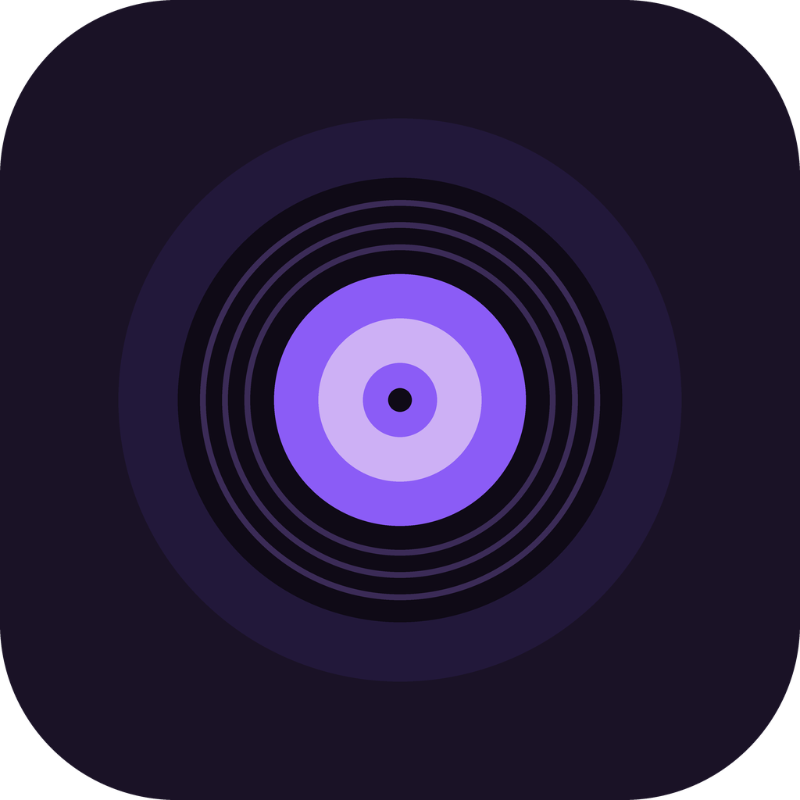
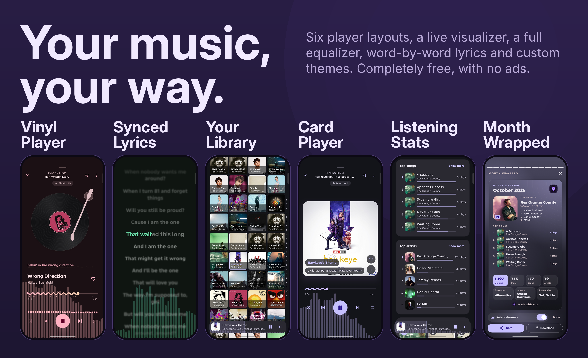
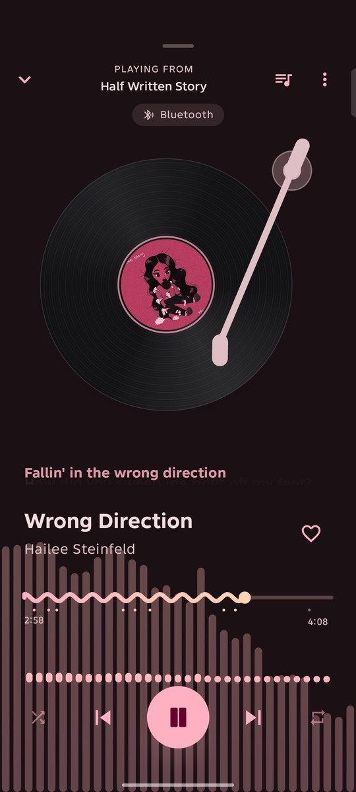
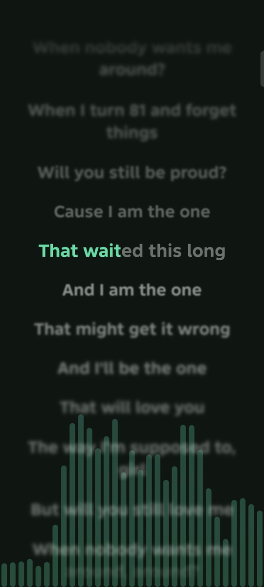
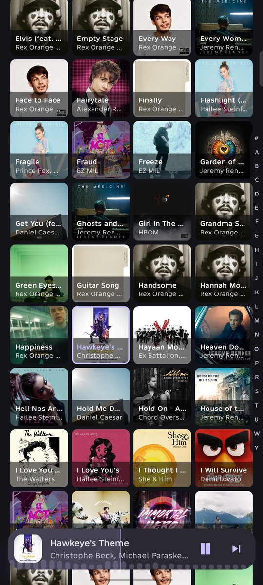
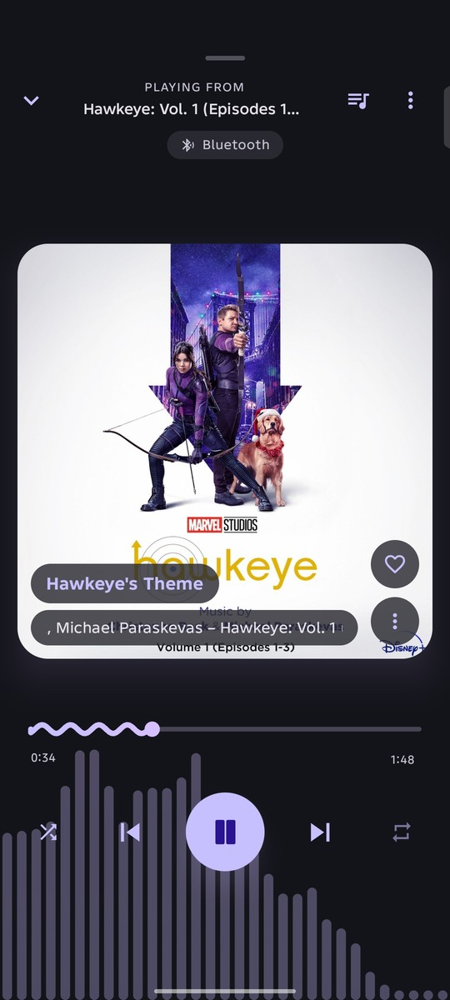
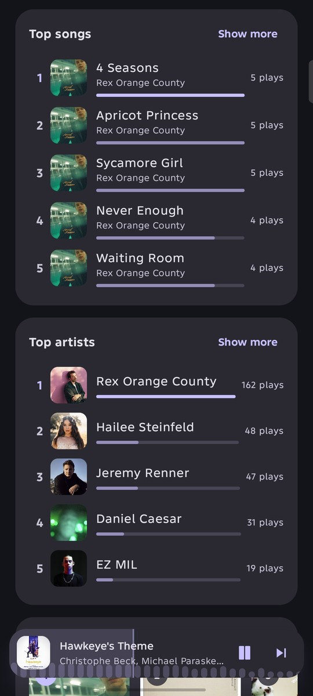
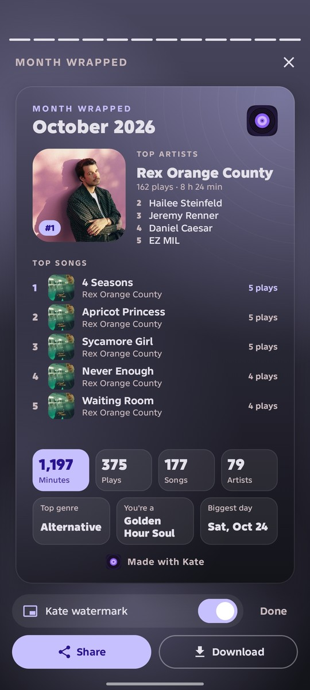

<div align="center">



# Kate

**Keep Audio Tracks Enjoyable**

Your music, your way.

[](LICENSE)
[](https://developer.android.com)
[](https://github.com/jhaiian/Kate/releases/tag/v1.0.0)
[](https://github.com/jhaiian/Kate/releases/tag/v1.0.0)
[](https://github.com/jhaiian/Kate/releases)
[](https://github.com/jhaiian/Kate)



[Download](#-download) • [Features](#-features) • [Screenshots](#-screenshots) • [Support](#-support-kate) • [License](#-license)

</div>

---

## 🎵 What is Kate?

Kate is an open-source music player for the songs already on your phone. No accounts, no streaming, no ads. Just your library, with great sound, synced lyrics, and a look you can make completely your own.

- **Sounds great**: a custom audio engine with hi-res playback, EQ, crossfade, and more.
- **Sings along**: synced lyrics, down to every word.
- **Looks like you**: themes, colors, fonts, and layouts you can change with a live preview.

Kate's custom theme system is powered by [Clint Gecko](https://github.com/jhaiian/ClintGecko), from the same Jhaiian ecosystem as [Clint Browser](https://github.com/jhaiian/ClintBrowser).

Built and maintained by **[@jhaiian](https://github.com/jhaiian)**, a solo developer from the Philippines 🇵🇭

---

## 📸 Screenshots

<div align="center">
  <table>
    <tr>
      <td align="center"></td>
      <td align="center"></td>
      <td align="center"></td>
      <td align="center"></td>
      <td align="center"></td>
      <td align="center"></td>
    </tr>
    <tr>
      <td align="center"><b>Vinyl Player</b></td>
      <td align="center"><b>Synced Lyrics</b></td>
      <td align="center"><b>Your Library</b></td>
      <td align="center"><b>Card Player</b></td>
      <td align="center"><b>Listening Stats</b></td>
      <td align="center"><b>Month Wrapped</b></td>
    </tr>
  </table>
</div>

---

## ✨ Features

### 🎨 Looks like yours

Most of the app is adjustable, and you can see the result in a live preview as you change it.

- **Six player layouts:** Classic, Big Art, Minimal, Vinyl, Cassette, and Card. The vinyl spins at 33⅓ or 45 RPM and the tonearm swings onto the record when you press play. The cassette comes in black, clear, or white.
- **Five seek bars:** Classic, Waveform, Squiggle, Pill, and Dots. The squiggle grows in loud parts and calms down in quiet ones, and the waveform is worked out from each song.
- **A visualizer** with bars, mirrored bars, a spectrum line, an oscilloscope, a ring, and a bass pulse. It can sit behind the player, above the controls, in the mini player, or behind the lyrics. Let the controls fade away so the visualizer takes over.
- **Colors:** dozens of accents, Material You, or your own color. The app or just the player can follow the album art. You can also set exact colors for the background, cards, and text.
- **Custom themes:** build your own theme with separate light and dark palettes, pick every color yourself, and check it in a live preview of the real app screens with a readability check.
- **Styles:** switch whole looks at once. Kate comes with six (Kate original, Studio, Retro deck, Vinyl lounge, Midnight, and Pop art). Save your own, share them as a file, or have Kate switch styles at night or when a certain output connects.
- **Buttons, icons, fonts, and text size.** You can load your own TTF or OTF font, and pick how buttons, switches, dialogs, and the navigation bar look.

### 🎧 Sound

- **Equalizer** with presets, bass and treble boost, and an **Advanced EQ** with parametric filters. Load an AutoEQ profile to correct your headphones.
- **A separate EQ for each output:** phone speaker, wired headphones, Bluetooth, and USB audio.
- **EQ that follows the music.** Link an EQ to a song, album, folder, or genre and Kate switches to it when that music plays.
- **Crossfeed, dynamics with a night mode, loudness compensation, a limiter, and a volume limit.**
- **ReplayGain** read from your files' tags, **crossfade** with three fade shapes, **gapless albums**, and **speed changes** that keep the original pitch.
- **Advanced, all off by default:** the Native Audio Engine (built on Oboe), High-Resolution Output, resampling to your phone's rate, and Bit-Perfect USB Output, which sends untouched audio to a USB DAC and needs Android 14 or newer.

### 🎤 Lyrics

- Reads lyrics from the song's tags or a `.lrc` file with the same name, and highlights **word by word** when the lyrics have word timing.
- **Find lyrics online** from AMLL TTML DB, lrc.red, LyricsPlus, NetEase Cloud Music, Kugou, and LRCLIB. This is off until you turn it on, and found lyrics are saved into the song so they work offline.
- **Make your own.** Paste the lyrics, play the song, and tap (or hold, for word by word) as each line is sung. Save them straight into the file.
- Share any lines as a **lyric card** image.

### 📚 Library

- **You pick the folders.** Kate reads them directly instead of going through Android's media database, so SD cards work. Exclude folders like ringtones and voice notes, and skip short tracks.
- **Browse by** songs, albums, artists, album artists, genres, folders, years, and recently added. Choose which categories show and in what order.
- **Smart playlists** built from rules like play count, last played, genre, year, and file format, with presets like Never Played and Forgotten Gems. M3U playlists import and export.
- **Artist and genre splitting.** A tag like "A, B feat. C" puts the song under each artist, and you can list names that should never be split.
- **Tag editor** for titles, artists, albums, covers, and more, with optional online lookup from MusicBrainz, Deezer, and iTunes.

### 🔀 Playing

- **Six shuffle modes:** True random, Spread artists, Fewer repeats, Discovery, Album shuffle, and Album mix.
- **Kate Radio** starts from a song and keeps going with similar ones from your library, matched on genre, artist, era, and what you usually listen to together.

### 📊 Listening stats

- **Top songs, artists, albums, and genres** by week, month, year, or all time, plus charts of when you listen.
- **Wrapped** for any week, month, or year, as a story you can save or share as an image.
- **Achievements** like Night Owl, Album Finisher, and Loyal Fan.
- History is saved only on your device, and you can turn it off or clear it.

### 📱 Everywhere else

- **Four widgets:** Now Playing, Album Art, Up Next, and Quick Play.
- **Android Auto**, and notification buttons you can choose.
- **Headset button actions** for single, double, triple, and long press.
- **Two-pane layout** on tablets, foldables, and wide screens.
- **Backup and restore** your settings, playlists, favorites, and listening history.

> Just download the app and explore it yourself.

---

## ⬇️ Download

Get the latest APK from GitHub, or add Kate to Obtainium to get updates automatically. Kate needs Android 8.0 (API 26) or higher.

<a href="https://github.com/jhaiian/Kate/releases/latest"></a>
<a href="https://apps.obtainium.imranr.dev/redirect?r=obtainium://add/https://github.com/jhaiian/Kate"></a>

To build it yourself you need JDK 17 and NDK `28.2.13676358`:

```
./gradlew assembleGithubRelease
```

---

## 💜 Support Kate

### Help Keep Kate Free Forever

Kate is an independent project built by one developer who thinks everyone should get a good music player without ads, paywalls or locked features. Donations help pay for development and maintenance, and Kate will always be free.

Thank you for being part of this journey. 💜

[](https://patreon.com/Jhaiian)
[](https://ko-fi.com/jhaiian)
[](https://paypal.me/jhaiian)
[](https://github.com/jhaiian/jhaiian/blob/main/docs/Insta%20Pay.jpg)

---

## 🤝 Contributing

Contributions, bug reports, and feature requests are welcome.

1. [Open an issue](https://github.com/jhaiian/Kate/issues) to report a bug or suggest a feature.
2. Fork the repo and create a branch for your change.
3. Submit a pull request with a clear description.

---

## 💬 Community

Join the official Kate community on Discord and Reddit to share feedback, report bugs, and connect with other music lovers.

- **Discord** – [discord.gg/cNZgT2AEQR](https://discord.gg/cNZgT2AEQR)
- **Reddit** – [reddit.com/r/KateMusic](https://www.reddit.com/r/KateMusic)

---

## ⭐ Star History

<a href="https://www.star-history.com/?repos=jhaiian%2Fkate&type=date&legend=top-left">
 <picture>
   <source media="(prefers-color-scheme: dark)" srcset="https://api.star-history.com/chart?repos=jhaiian/kate&type=date&theme=dark&legend=top-left" />
   <source media="(prefers-color-scheme: light)" srcset="https://api.star-history.com/chart?repos=jhaiian/kate&type=date&legend=top-left" />
   
 </picture>
</a>

---

## 📄 License

The source code of this project is licensed under the [GNU General Public License v3.0 (GPLv3)](LICENSE).

The name "Kate," the logo, screenshots, and all related branding assets are **trademarks** or **proprietary assets** of the author and are **not licensed under the GPL**. Using them requires explicit permission from the author.

The libraries used in Kate keep their own licenses. See [Attribution.md](Attribution.md) for the full list.
